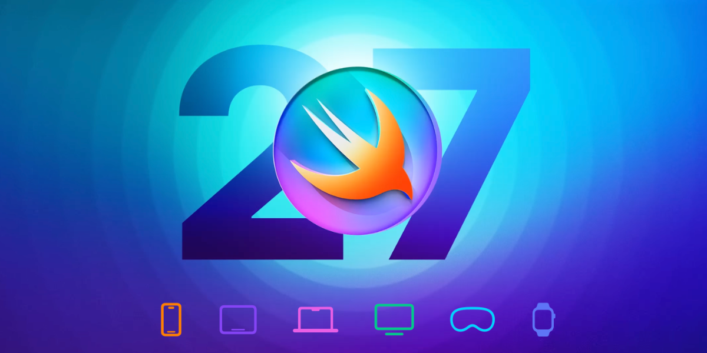

# WWDC 2027 - Swift Student Challenge

List of student submissions for the WWDC 2027 - Swift Student Challenge. The list is in alphabetical order.

### How to add your submission?
1. **[Click here to open the form](https://github.com/wwdc/2027/issues/new?template=submit.yml)** and fill it in.
2. Send it. A bot checks your entry within a minute and tells you if anything needs fixing. You can edit the form after sending.
3. When it is approved your entry appears on this list.

#### How to update or remove your submission?
Use the **[update form](https://github.com/wwdc/2027/issues/new?template=update.yml)**. Only the person who sent the entry can change it.

### Submissions

| Participant | Links  | Status                |
|:--|:--|:--|

##### Total: 0 | Awarded: 0
